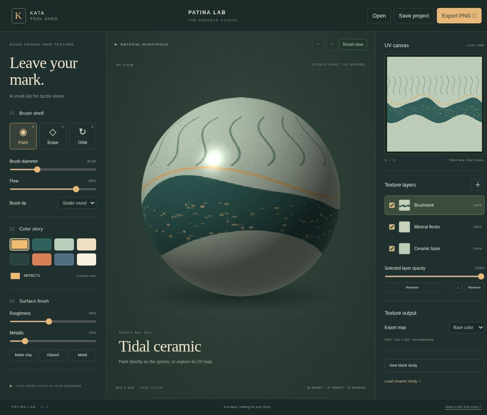
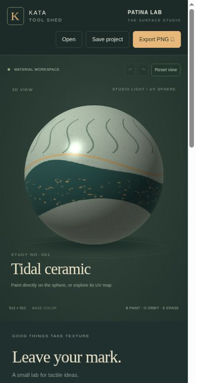

# Kata Patina Lab

**Every surface tells a story.** An original, local-first surface painting kata inspired by Substance 3D Painter's direct-on-mesh painting and layered texturing workflow.

Part of [Kata Tool Shed](https://intrepion.github.io/tools/). Repository: `kata-app-inspired-by-substance-3d-painter-codex-dot`.

## Screenshots

Genuine browser captures of the running HTTP app, not mockups.



<details><summary>390-pixel narrow layout</summary>



</details>

## Run

Requires Node.js 18 or newer. No dependencies to install.

```sh
npm run dev
# Open http://127.0.0.1:4187
npm run check
npm run build
```

Use `PORT=4300 npm run dev` for another port, or `$env:PORT=4300; npm run dev` in PowerShell. Always open the HTTP app, not `index.html` directly. The build copies static production files to `dist/`, ready to serve over HTTP.

## Paint a surface

1. Start with the original **Tidal ceramic** study or choose **New blank study**.
2. Paint directly on the shaded 3D sphere, or use the linked 512 × 512 UV canvas. The sphere uses a latitude/longitude UV layout.
3. Choose a Studio round or Dry grain tip, adjust diameter/flow, and pick a palette or custom color. Erase removes paint from only the selected layer.
4. Press **O** for orbit and drag to inspect the material. **B** returns to paint, **E** selects erase.
5. Add up to six layers. Select, rename, hide, reorder, remove and change opacity. Undo and redo retain twenty edits, including raster pixels and material settings.
6. Adjust roughness and metallic or use Matte clay, Glazed and Metal finish presets.
7. Save an editable `.patina` project with embedded PNG layers. Open it to continue later.
8. Choose Base color, Roughness or Metallic under **Texture output**, then **Export PNG**. Each click downloads one map at 512 × 512. The roughness and metallic maps are uniform grayscale images of the chosen material values.

Transparent areas of the 3D preview use a neutral gray substrate. Base-color exports preserve their actual transparency, so the exported transparent areas are not painted gray.

## Keyboard and accessibility

Controls are labeled and show visible focus. Ctrl/Cmd+S saves the project; Ctrl/Cmd+Z and Ctrl/Cmd+Shift+Z undo/redo outside form fields. Focus the 3D canvas and use Left/Right arrows to rotate, or Space to stamp at its center. Focus the UV canvas and use arrow keys to move a keyboard brush cursor, Shift+arrows for larger steps, and Space to stamp. Cursor coordinates are announced in the status line. This is a visual creative tool, not a full nonvisual painting interface.

The responsive layout places the 3D workspace first on narrow screens and retains every control below. Pointer events support mouse and touch. Pen-pressure painting is not implemented.

## Scope and honest limits

This is a compact **sphere-only texture workshop**, not a Substance 3D Painter replacement. It has real raster painting, UV seam-aware stroke interpolation, layered compositing, editable saves and image exports. A custom CPU sphere renderer samples the texture and approximates lighting, roughness and metallic highlights. It is **not a physically based renderer**.

It does not import arbitrary meshes, bake normals/AO, generate smart materials, provide masks or blend modes, paint separate PBR channels, support UDIMs, unwrap UVs, import Substance files, or export a mesh. All geometry is the built-in UV sphere. UV projection stretches toward the poles. The brush diameter is defined in UV texture pixels, not in world-space units. Adjacent paint dabs build up flow. Undo history is memory-only; selected layer and brush settings are session controls, not saved project fields.

## Local persistence and file handling

No account, backend, telemetry, external asset requests or uploads. Best-effort autosave uses `kata-patina-v1` in origin-specific local storage. Quota, private mode, browser cleanup or a different hostname/port can affect persistence; errors are shown. **Download projects for durable backups.**

Projects validate format, material ranges, 1–6 layers, opacity and names. Only embedded PNG data is accepted, with a 3 MB encoded limit per layer, 18 MB file limit and exact 512 × 512 decoded dimensions. Imports decode fully before replacing the current artwork. Imported names are rendered as text. Loading a project or study warns before replacing unsaved changes and remains undoable.

## Verification

`npm run check` runs JavaScript syntax checks and eleven Node tests covering sphere mapping, UV seam interpolation, project validation, history and HTTP serving. `/tests/browser.html` exercises painting, undo/redo, layers, finish, orbit, project import/export and PNG output through a running local server. Test pages are excluded from the static build. See [QA notes](docs/QA.md).

## Structure

- `src/model.js`: UV math, stroke interpolation, validation and history.
- `src/app.js`: original study generation, raster layers, shading, input, UI, local persistence and export.
- `docs/INSPIRATION.md`: source research and scope decisions.
- `app.json`: Tool Shed metadata, inspiration and screenshots.

## License and attribution

MIT, see [LICENSE](LICENSE). All code, design, palettes and the procedural ceramic study are original. [Substance 3D Painter](https://www.adobe.com/products/substance3d/apps/painter.html) is an Adobe product. This independent exercise is not affiliated with or endorsed by Adobe and has no proprietary file compatibility. The combined `.gitignore` covers Windows, macOS, Linux/Unix, editors, builds and local secrets.

This is an independent educational kata. See the QA notes for verification scope and limitations.
